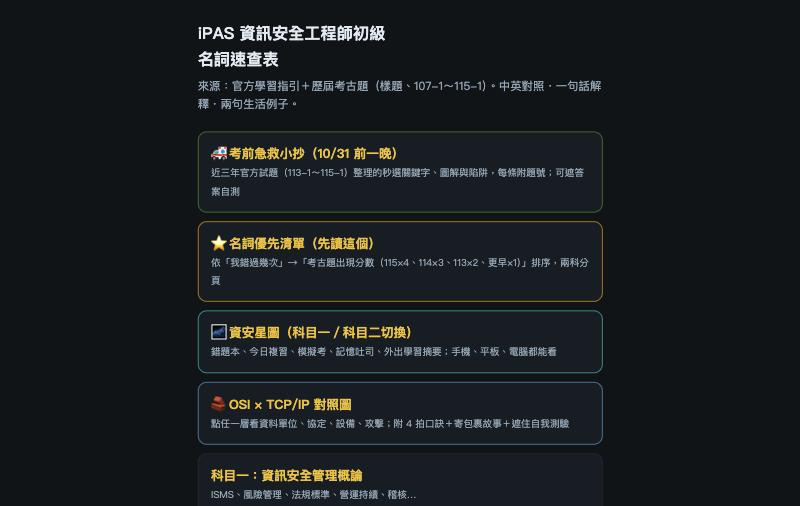

# iPAS 資安名詞速查表

把分散在學習指引與考古題中的資安名詞，整理成手機也能即時搜尋的白話卡片。

[開啟線上速查表](https://anthea1003-bit.github.io/ipas-infosec-glossary/)

## 解決什麼問題

準備資安考試時，同一名詞常散落在不同年份的題目裡，來回翻找容易中斷學習。這份速查表把中英文名稱、白話解釋與生活例子放在一起，輸入關鍵字就能查找。每張卡片保留來源標記，方便回頭核對。

## 內容規模

科目一 593 條、科目二 810 條，共 1,403 條名詞；整理來源包含官方學習指引及 34 份樣題與歷屆試題。

## 怎麼做的

依學習指引分類，把名詞整理成中英對照、簡短解釋與生活例子，再由 AI 工具產生可搜尋的網頁。製作流程由另一個 AI 模型審核每版內容，Anthea 裁決修改與取捨；來源標記供學習者自行查核。

## Anthea 的角色

提出需求與規則、驗收結果、決定取捨；程式由 AI 工具（Codex／Claude）產生。

## 授權與注意

iPAS 考題引用自公開考古題，僅供學習，題目權利歸原權利人。此工具為個人整理，並非官方教材；解釋有疑義時請回查原始資料。
